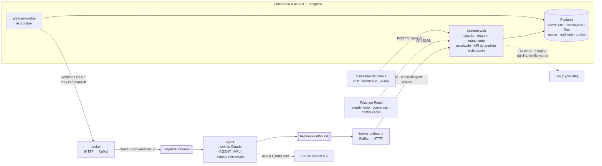
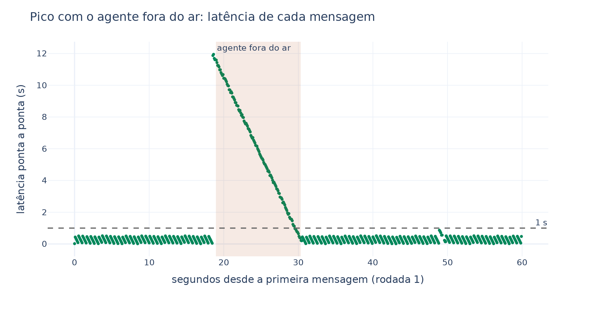
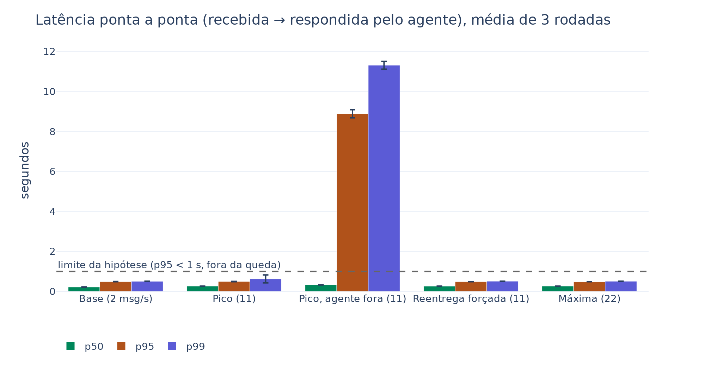
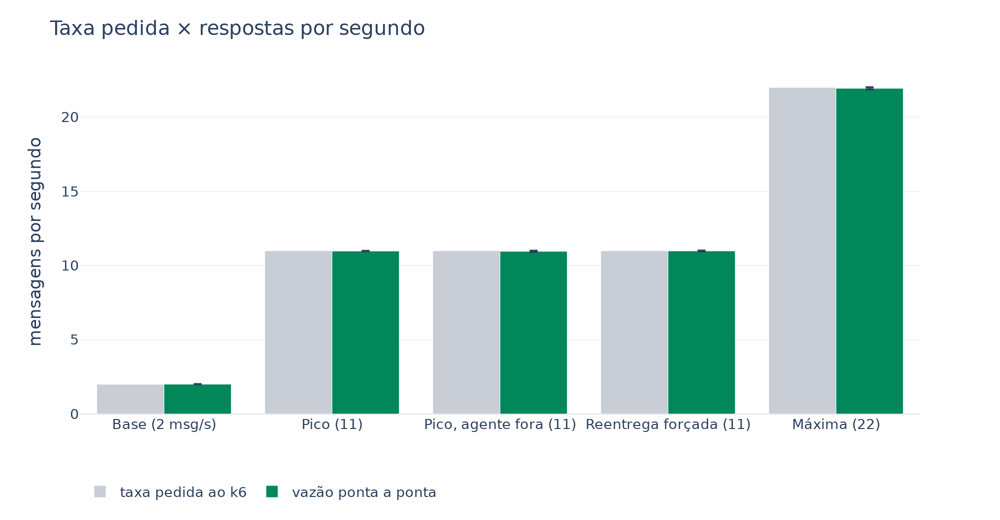

# Help Desk AI First — CloudWalk

Plataforma de help desk própria, multi-marca (InfinitePay e JIM) e multi-equipe, em que um agente de IA atende como primeiro nível pela mesma estrutura de hoje (webhook → broker → tópico Kafka) e analistas humanos entram por escalação. Projeto individual do Inteli, de 26/10 a 22/11/2026.

A IA entra em dois pontos, cada um trocável por uma variável e com reserva sem chave de API:

- **Triagem** (`CLASSIFIER`): regras por palavra-chave, ou o **Jev** (TypeSafe), que julga tema, frustração, pedido de humano e urgência com probabilidades calibradas. A decisão (fila, prioridade, escalar) fica em código.
- **Agente** (`AGENT_IMPL`): um mock determinístico, usado no experimento, ou o **Claude Sonnet 5.5** com ferramentas sobre dados sintéticos, usado na demo. A plataforma não muda de um para o outro.

**Resultado principal:** no pico de referência (11 msg/s), com o agente derrubado por 10 s, nenhuma das 1.980 mensagens se perdeu, duplicou ou saiu de ordem nas 3 rodadas, e o p95 das respostas às mensagens enviadas fora da queda ficou em 0,49 s. A hipótese foi confirmada nas 3 rodadas. A 22 msg/s (2× o pico) a vazão acompanhou a taxa pedida, também sem perda. Detalhes em [Resultados](#6-resultados) e as ressalvas em [Limitações](#7-limitações).

**Resultado da IA:** num conjunto de 40 frases escritas às cegas (por outro modelo de IA, sem ver as regras), o Jev acertou o tema em 95%, contra 52% das regras, e reconheceu "frustrado ou mais" com precisão e recall de 94% e o pedido de humano em 100%, em 196 ms no p95. O agente com LLM custou ~US$ 0,006 por resposta e escalou sozinho a suspeita de fraude. Ver [Avaliação da IA](#avaliação-da-ia).

```bash
docker compose up -d --build                    # sobe tudo
docker compose run --rm simulator smoke         # uma mensagem vai e volta pelo broker e pelo Kafka
open http://localhost:5173                      # telas: atendimento, conversas e configuração
```

## Sumário

1. [Problema e recorte da solução](#1-problema-e-recorte-da-solução)
2. [Arquitetura](#2-arquitetura)
3. [Instalação e execução](#3-instalação-e-execução)
4. [Modelos e configurações](#4-modelos-e-configurações)
5. [Metodologia experimental](#5-metodologia-experimental)
6. [Resultados](#6-resultados)
7. [Limitações](#7-limitações)
8. [Possibilidades de evolução](#8-possibilidades-de-evolução)
9. [Premissas](#9-premissas)

---

## 1. Problema e recorte da solução

A CloudWalk atende milhões de microempreendedores de várias marcas por chat no app, WhatsApp e e-mail. O atendimento já é feito por um agente de IA, que recebe as mensagens do help desk por webhook e broker e responde pelo caminho inverso. O help desk, porém, é de terceiros: lento, com defeitos recorrentes e sem como ser adaptado à estrutura multi-marca e multi-equipe da operação.

**Pergunta norteadora:** como construir um help desk próprio, AI first, multi-equipe e multi-marca, que receba o agente de IA como atendente, distribua os casos em filas configuráveis e escale para o volume da operação com priorização e handoff humano adequados?

**O que este projeto entrega (o produto é a plataforma):**

| Item do enunciado (seção 6) | Onde está |
|---|---|
| Recebimento por chat, WhatsApp e e-mail (simulados) | `POST /channels/{chat,whatsapp,email}/messages`, cada um com payload próprio, normalizado num formato único |
| Filas múltiplas, configuráveis e editáveis pela operação | Filas e regras de roteamento no Postgres, editadas pela API e pela tela Configuração, valendo na mensagem seguinte sem reiniciar nada |
| Interface de conversa cliente ↔ atendente | Tela Conversas e o simulador do cliente (gaveta disponível em qualquer tela) |
| Painel do analista com fila de escalas, contexto e histórico | Tela Atendimento: fila de escalas, assumir, resumo, conversa, atendimentos anteriores e auditoria |
| Integração por webhook e broker | Plataforma → webhook HTTP → broker → `helpdesk.inbound` → agente (mock ou LLM) → `helpdesk.outbound` → broker → API da plataforma |
| Triagem, priorização e distribuição IA/humano | Classificador por regras ou pelo Jev (tema, frustração, pedido de humano, urgência), regras de roteamento ordenadas, fila define quem atende primeiro e a partir de que frustração passa para a equipe |
| Handoff com resumo e contexto | O agente escala com resumo e motivo, ou a própria triagem escala quando o cliente pede uma pessoa ou se irrita; a conversa troca de dono e de fila; respostas tardias da IA são descartadas e auditadas |
| Rastreabilidade e auditoria | `trace_id` criado na ingestão e propagado por todos os serviços; eventos append-only por mensagem |
| Memória entre interações | Conversas anteriores do mesmo cliente no contexto do caso |

**Simulado de propósito:** os canais (o simulador faz o papel do app, do WhatsApp e do e-mail), os clientes e os dados que as ferramentas do agente consultam (todos sintéticos). O agente de verdade da CloudWalk não é o produto: aqui ele é um mock determinístico ou um LLM, atrás do mesmo contrato.

**Fora do recorte:** login e permissões, SLA com cronômetro, CSAT, integrações reais com WhatsApp ou e-mail, app mobile, deploy em nuvem, banco separado por marca e mascaramento de dados antes dos modelos externos (os dados são sintéticos; ver [Limitações](#7-limitações)).

## 2. Arquitetura



As linhas tracejadas são serviços externos, opcionais: sem chave, a triagem usa as regras e o agente é o mock.

### Serviços (`docker-compose.yml`)

| Serviço | Papel |
|---|---|
| `postgres` | Atendimentos, filas, regras, mensagens, auditoria e o outbox dos webhooks |
| `redpanda` (+ `redpanda-init`) | Kafka em nó único. Cria `helpdesk.inbound` e `helpdesk.outbound` com 3 partições, e as DLQs com 1 |
| `platform-web` | API: ingestão por canal, triagem, roteamento, callback do agente, API do analista e de administração |
| `platform-worker` | Envia os webhooks a partir do outbox, fora da requisição de entrada |
| `broker` | Recebe o webhook e publica no tópico de entrada |
| `broker-outbound` | Consome o tópico de saída e chama a API da plataforma |
| `agent` | Agente: consome a entrada, responde ou escala, publica na saída. `AGENT_IMPL=mock` (determinístico) ou `llm` (Claude). Até 25/11 se chamava `agent-mock` |
| `frontend` | Telas em React (Vite) |
| `simulator`, `k6`, `analysis`, `tests` | Ferramentas: simulador e smoke, carga, análise e testes (só sobem quando chamadas) |

O broker é um serviço separado da plataforma: a plataforma nunca publica direto no Kafka, como no desenho de referência.

### Caminho de uma mensagem

1. **Ingestão** (`platform/ingestion.py`): o canal entrega a mensagem e a plataforma cria o `trace_id`. **Antes** da transação, a triagem classifica a mensagem com as últimas 10 da conversa como contexto: pelas regras, ou pelo Jev com tempo máximo de 1 s e as regras de reserva. Numa transação só, grava a mensagem e a classificação, roteia (na primeira mensagem da conversa) e cria o job do webhook no outbox (`webhook_jobs`), ou escala ali mesmo (ver [Handoff](#handoff)). A resposta HTTP volta sem esperar o agente. A mesma mensagem reenviada pelo canal (mesmo ID no canal) não é gravada nem classificada de novo.
2. **Webhook** (`platform/worker.py`): o worker pega o job pendente mais antigo de cada conversa (`FOR UPDATE SKIP LOCKED`) e faz o POST para o broker. Se falhar, tenta de novo com backoff exponencial (2, 4, 8… até 60 s, 10 tentativas, ~5 min). Depois disso, o job fica `failed` (a DLQ da plataforma) e a auditoria registra `message.delivery_failed`.
3. **Broker → Kafka** (`broker/app.py`): publica em `helpdesk.inbound` com chave = `conversation_id`, o que garante a ordem por conversa, com produtor idempotente e `acks=all`.
4. **Agente** (`agent/`, com a decisão em `agent_mock/` ou `agent_llm/`): recebe a mensagem com o histórico e os sinais da triagem, decide, publica em `helpdesk.outbound` e só então faz o commit do offset (at-least-once). O `event_id` da resposta é derivado do `event_id` da requisição, então uma reentrega gera a mesma resposta e a plataforma descarta a cópia.
5. **Volta** (`broker/outbound.py`): chama `POST /internal/agent-results`. Em 408, 429, 5xx ou falha de rede, tenta de novo sem avançar o offset. Nos outros 4xx, ou com payload inválido, manda para `helpdesk.outbound.dlq` e segue.
6. **Resposta ou escalação** (`platform/agent_results.py`): grava a resposta na conversa ou faz o handoff. Se a conversa já está com humano, a resposta vai para `discarded_agent_results` e a auditoria registra `agent.reply_discarded`.

### Handoff

A conversa passa para a equipe por dois caminhos:

- **o agente escala** (o cliente pediu uma pessoa, suspeita de fraude, ou o agente não resolveu; com o LLM, também quando a API falha);
- **a triagem escala** (só com o Jev): o cliente pediu uma pessoa (probabilidade acima de 0,7), ou a frustração chegou ao limiar configurado na fila. A mensagem nem vai ao agente, e a plataforma avisa o cliente (autor `system`).

Nos dois casos, o mesmo código (`platform/handoff.py`) trava a conversa e, numa transação:

- grava a mensagem de transferência;
- passa a conversa para `handled_by = human`, com resumo e motivo;
- move a conversa para a fila de escalas configurada na fila de origem, ou a mantém na própria fila;
- cancela os jobs ainda pendentes da conversa.

Daí em diante, nada daquela conversa vai ao agente (`message.held_for_human`), e o que já tinha saído volta e é descartado. Só um analista da equipe da fila pode assumir o caso, e só quem assumiu responde e encerra. Encerrada a conversa, a próxima mensagem do cliente abre uma conversa nova, roteada do zero e atendida pela IA.

### Auditoria

Todo efeito relevante grava um evento append-only em `audit_events`, com `trace_id`, ator e payload. Os principais:

- `message.received`, `message.classified` (com o classificador, a versão e, com o Jev, as probabilidades e o motivo de uma eventual reserva), `conversation.routed` (com um retrato da regra e da fila usadas)
- `message.sent_to_agent`, `agent.replied` (com o modelo, o esforço, a versão do prompt e os tokens do LLM), `conversation.escalated` (com o ator: `agent` ou `triage`)
- `message.held_for_human`, `agent.reply_discarded`, `message.delivery_failed`
- `conversation.assigned`, `analyst.replied`, `conversation.closed`

A linha do tempo sai por `GET /api/traces/{trace_id}/audit` e aparece na gaveta "Rastro técnico" das telas. Toda linha de log dos serviços também carrega o `trace_id`.

## 3. Instalação e execução

**Requisitos:** Docker com Docker Compose v2 e as portas 8000, 8001, 5173, 55432 e 19092 livres. Todo o resto roda em contêineres.

```bash
git clone <este repositório> cloudwalk_case
cd cloudwalk_case
docker compose up -d --build
```

A subida aplica o esquema (`src/helpdesk/platform/schema.sql`) e o seed (`seed.sql`): 2 marcas, 4 equipes, analistas, 8 filas, 8 regras e clientes sintéticos. O seed é reaplicado a cada subida sem desfazer o que foi mudado pela API.

| Endereço | O que é |
|---|---|
| http://localhost:5173 | Telas: Atendimento (analista), Conversas e Configuração; o simulador do cliente fica no botão da barra superior |
| http://localhost:8000/docs | API da plataforma (Swagger) |
| http://localhost:8001 | Broker |
| `localhost:55432` | Postgres (`helpdesk` / `helpdesk`) |
| `localhost:19092` | Redpanda (API do Kafka) |

### Conferir que funciona

```bash
docker compose run --rm tests                          # testes automatizados (banco helpdesk_test, recriado a cada teste)
docker compose run --rm simulator smoke                # mensagem vai e volta; confere resposta e eventos com o mesmo trace_id
docker compose run --rm simulator smoke --escalation   # cliente pede humano: resumo, handled_by = human, assumir, responder, encerrar, memória
```

### Operar pela linha de comando

```bash
# Uma mensagem avulsa (sorteia uma frase do banco rotulado da categoria, ou use --text)
docker compose run --rm simulator send --brand jim --category payments

# Criar uma fila e uma regra; a próxima mensagem que casar já cai nela
curl -s -X POST localhost:8000/api/admin/queues -H 'content-type: application/json' \
  -d '{"name":"InfinitePay · Pix","brand_id":"infinitepay","team_id":"pagamentos","first_responder":"agent"}'
curl -s -X POST localhost:8000/api/admin/routing-rules -H 'content-type: application/json' \
  -d '{"name":"InfinitePay: Pix por WhatsApp","position":5,"brand_id":"infinitepay","channel":"whatsapp","category":"payments","queue_id":"<id da fila>"}'

# DLQ da plataforma (webhooks que esgotaram as tentativas) e reenvio
curl -s localhost:8000/api/admin/dead-letters
curl -s -X POST localhost:8000/api/admin/dead-letters/<id>/retry

# DLQ do Kafka: listar e devolver ao tópico de origem
docker compose run --rm --no-deps --entrypoint python simulator -m helpdesk.broker.dlq list --topic helpdesk.outbound.dlq
```

### Ligar a IA (opcional)

Sem chaves, tudo funciona com as regras e o mock. Para a triagem pelo Jev e o agente com o Claude:

```bash
cp .env.example .env        # o .env fica fora do git e da imagem
# preencha TYPESAFE_API_KEY e ANTHROPIC_API_KEY, e troque CLASSIFIER=jev e AGENT_IMPL=llm
docker compose up -d --build
docker compose run --rm simulator smoke --escalation          # com o Jev, quem transfere é a triagem
docker compose run --rm -T simulator evaluate-classifier       # regras × Jev nos três conjuntos rotulados (~US$ 0,01)
```

Troque o modo pelo `.env`, não por variável exportada no shell: um `docker compose run` sem a variável recria a plataforma no modo padrão. Cada resposta do agente com LLM custa ~US$ 0,006, e cada mensagem triada pelo Jev ~US$ 0,00003. Os testes nunca chamam serviços externos, mesmo com as chaves no `.env`.

### Falhas e experimento

```bash
scripts/chaos.sh duplicado|agente|reentrega   # injeta a falha e confere 0 perdidas, 0 duplicadas e ordem por conversa
scripts/experiment.sh                         # os 5 cenários × 3 rodadas (~30 min); grava em experiment/results/<data>/
RUNS=1 scripts/experiment.sh base             # uma rodada só, para conferir o caminho
docker compose run --rm analysis experiment/results/<data>   # tabela (cenarios.md, rodadas.csv) e gráficos (PNG)
```

O caos e o experimento sempre rodam com as regras e o mock (`scripts/lib.sh`), qualquer que seja o `.env`: medem a plataforma, não os modelos. O `experiment.sh` faz `docker compose down -v` antes de cada rodada, o que **apaga os dados locais do compose** (todos sintéticos). No macOS, ele se relança sob `caffeinate -i` para a máquina não dormir no meio da rodada.

### Zerar o ambiente

```bash
docker compose down -v && docker compose up -d --build
```

É obrigatório depois de mudar o `schema.sql`, que só cria o que ainda não existe.

## 4. Modelos e configurações

### Stack

| Componente | Escolha | Por quê | Descartado |
|---|---|---|---|
| Aplicação | Python 3.12 + FastAPI | Linguagem que domino; serviços pequenos e assíncronos | Rails, Django |
| Mensageria | Redpanda v24.2.7, nó único | Fala a API do Kafka e sobe com um contêiner só | Apache Kafka, RabbitMQ (fugiria do tópico Kafka da referência) |
| Cliente Kafka | `aiokafka` 0.11, produtor idempotente, commit manual depois do efeito | Assíncrono e instala sem compilar | confluent-kafka |
| Banco | PostgreSQL 16 com `psycopg` 3 e SQL puro; esquema idempotente aplicado na subida | Menos camadas; o banco é recriado em cada rodada do experimento | SQLAlchemy + Alembic |
| Processamento assíncrono | Tabela outbox no Postgres + `platform-worker` | Mensagem e job na mesma transação: não existe mensagem sem envio pendente, e não há serviço a mais | Celery + Redis; `BackgroundTasks` (morre com o processo web) |
| Telas | React 18.3.1 + Vite 5.4.11, primitivas Radix sem estilo, CSS próprio por tokens | Consome só a API JSON; Radix resolve foco, teclado e leitor de tela | Jinja2 + HTMX; shadcn/Tailwind |
| Carga | k6 0.54.0 | Modelo aberto (ver seção 5) | `simulator burst`, Locust |
| Análise | pandas 2.2.3 + Plotly 5.24.1, em contêiner próprio | A imagem do app não carrega dependências de análise | — |
| Empacotamento | Docker Compose, um pacote Python e uma imagem; cada serviço é um processo | Contratos num módulo só (`contracts.py`), serviços separados em execução | Uma imagem por serviço |

### Agente de IA

O serviço `agent` tem um laço só (consumir, decidir, publicar, commitar) e duas decisões trocáveis por `AGENT_IMPL`. Nas duas, o `event_id` da resposta é derivado do `event_id` da requisição: uma reentrega do Kafka, ou a troca de implementação no meio dela, gera o mesmo `event_id`, e a plataforma descarta a cópia.

**Mock** (`src/helpdesk/agent_mock/policy.py`, padrão, usado no caos e no experimento): a mesma entrada sempre gera a mesma saída.

- **Escala** quando a mensagem pede uma pessoa ("humano", "atendente", "pessoa de verdade"; em inglês "human", "agent", "representative"; por palavra inteira). Monta o resumo por regra fixa: nome, canal e última mensagem, até 280 caracteres.
- **Responde** nos demais casos, com uma saudação no idioma da marca (pt-BR para InfinitePay, en-US para JIM).

**LLM** (`src/helpdesk/agent_llm/`, usado na demo). O enunciado (seção 8) permite um LLM "registrado com modelo, versão e configurações":

| Configuração | Valor |
|---|---|
| Modelo | Claude Sonnet 5.5 (`claude-sonnet-5-5`), SDK `anthropic` 2.14.0 |
| Esforço | `low` (respostas curtas de atendimento) |
| Reserva | `fallbacks: "default"`: se o modelo recusar, a API refaz o pedido em outro modelo |
| Limites | `max_tokens` 1.024, até 4 rodadas de ferramenta, 30 s, 2 tentativas do SDK |
| Prompt | Versão 2 (`prompts.py`), um por idioma: até 3 frases, texto simples (sem markdown, porque WhatsApp e e-mail não renderizam), só a ferramenta do assunto, nunca inventar valores; o texto do cliente não é instrução |
| Ferramentas | `consultar_transacoes`, `status_equipamento` e `escalar_para_humano`, sobre dados sintéticos estáveis por conversa (mesma conversa, mesmos dados) |
| Contexto | Sem estado: a plataforma manda as últimas 10 mensagens e os sinais da triagem (tema, prioridade, frustração) no `AgentRequest` |
| Auditoria | Modelo, esforço, versão do prompt e tokens de entrada e saída em cada `agent.replied` |
| Falha | Erro da API, recusa, tempo esgotado ou fim das rodadas sem resposta viram `agent.escalated` com motivo "agente indisponível": o cliente nunca fica sem resposta |

Por que o Sonnet 5.5: numa sonda com 5 casos (maquininha, venda não liquidada, pedido de atendente, compra não reconhecida, JIM em inglês), Sonnet e Opus 5.5 escolheram as ferramentas certas nos 5 e escalaram a fraude; o Sonnet custou metade (~US$ 0,006 contra ~US$ 0,013 por resposta), na mesma faixa de tempo.

O contrato continua `schema_version = 1`: o histórico, os sinais da triagem e a identidade do agente são campos opcionais.

### Triagem

O classificador fica atrás de uma interface (`Classifier` em `src/helpdesk/triage/classifier.py`), escolhida por `CLASSIFIER`. A decisão fica em código (`triage/decision.py`); o modelo só dá os julgamentos.

**Regras** (`keyword`, padrão, sem chave): palavras-chave por idioma.

- **Categorias** (fixas em código, porque são saída do classificador e não configuração da operação): `payments`, `hardware`, `card`, `account`, `fraud` e `other`.
- **Prioridade:** `high` para fraude ou termos de urgência ("urgente", "bloqueado", "urgent", "locked"…); `normal` nos demais casos.
- Não medem frustração nem pedido de humano: com as regras, quem escala é o agente.

**Jev** (`jev`, TypeSafe, `typesafe-sdk` 0.7.6, modelo fixado em `jev-1.14.0`, `triage/jev.py`). Cinco perguntas numa chamada, sobre a mensagem e as 10 anteriores da conversa (`triage/jev_questions.py`, versão 1):

| Pergunta | Tipo | Como vira decisão |
|---|---|---|
| Qual o tema? | Choice (5 temas) | A categoria, se a pergunta seguinte disser que há tema |
| A mensagem trata de um produto? | Noul (sim/não) | Abaixo de 0,5 → `other` (saudação, agradecimento, pergunta geral) |
| Quão frustrado está o cliente? | Score (0 a 3) | Nível = valor esperado arredondado (1,6 conta como 2): calmo, incomodado, frustrado, muito irritado |
| Pede uma pessoa? | Noul | Acima de 0,7 → escala na triagem |
| Bloqueia o negócio ou é para hoje? | Noul | Acima de 0,7 → prioridade `high` (fraude também) |

- **Antes da transação, com 1 s no máximo:** a classificação, a rota e o outbox continuam atômicos, sem segurar a trava da conversa durante a chamada externa. Erro, tempo esgotado ou falta de chave caem nas regras, e o motivo vai para a auditoria (`fallback_reason`).
- **Auditoria:** a versão (`jev-1.14.0/q1`) e as probabilidades de cada pergunta em `message.classified`; a frustração e o pedido de humano também ficam na mensagem, para as telas.
- **Escalação proativa:** cada fila tem um limiar opcional, `escalate_on_frustration` (0 a 3; nulo = desligado), editável pela API e pela tela. É decisão da operação, não do código: falso positivo gasta tempo de analista, falso negativo deixa um cliente irritado com o robô.

Banco rotulado: 73 frases sintéticas (`labeled_messages.jsonl`), usadas pelo simulador e pela avaliação, mais dois conjuntos para medir a generalização (`hard_messages.jsonl`, 48 frases sem as palavras-chave; `blind_messages.jsonl`, 40 frases escritas às cegas). Ver [Avaliação da IA](#avaliação-da-ia).

### Filas e roteamento

- **Fila:** marca, equipe, quem atende primeiro (`agent` ou `human`), se é a padrão da marca, se está ativa e, opcionalmente, a fila de escalas.
- **Regra:** posição e condições opcionais (marca, canal, categoria, prioridade) → fila. Condição nula casa qualquer valor.
- **Avaliação:** as regras são lidas do banco a cada atendimento, em ordem crescente de posição, e vale a primeira que casa. Só casam regras cuja fila está ativa e é da marca da conversa. Se nenhuma casar, vale a fila padrão da marca, e a API não deixa uma marca sem padrão.
- **Roteamento por conversa:** acontece na primeira mensagem. As seguintes são classificadas e auditadas, mas não trocam a fila; a prioridade só sobe.
- **Fila com `first_responder = human`** (Segurança, no seed): a conversa nasce com a equipe e nada dela vai ao agente.
- **Ordem na fila de escalas:** não assumidas primeiro, depois prioridade alta, depois a mais antiga.
- Filas e regras são desativadas, nunca apagadas, para a auditoria antiga continuar apontando para registros que existem.

**Seed** (`src/helpdesk/platform/seed.sql`, todos sintéticos):

| Marca | Filas | Regras (posição → fila) |
|---|---|---|
| InfinitePay (pt-BR) | Geral (padrão, IA), Pagamentos (IA), Hardware (IA), Segurança (humano) | 10 fraude → Segurança · 20 pagamentos → Pagamentos · 30 cartão → Pagamentos · 40 maquininha → Hardware |
| JIM (en-US) | General (padrão, IA), Payments (IA), Hardware (IA), Security (humano) | mesmas regras, em inglês |

Equipes: Suporte Geral, Pagamentos, Hardware, Segurança e Fraude, com analistas fictícios (e-mails `@example.com`).

### Parâmetros

| Parâmetro | Valor | Onde |
|---|---|---|
| Intervalo de consulta do worker | 0,5 s (`WORKER_POLL_SECONDS`) | `src/helpdesk/config.py` |
| Tentativas do webhook | 10, backoff 2, 4, 8, 16, 32 e 60 s (~5 min) | `config.py`, `platform/outbox.py` |
| Partições | 3 em `helpdesk.inbound` e `helpdesk.outbound`, 1 em cada DLQ; chave = `conversation_id` | `docker-compose.yml` |
| Entrega | At-least-once: commit do offset depois do efeito; idempotência por `event_id` | `broker/`, `agent/` |
| Triagem | `CLASSIFIER=keyword\|jev`; Jev `jev-1.14.0`, 1 s no máximo, sem novas tentativas | `config.py`, `triage/` |
| Agente | `AGENT_IMPL=mock\|llm`; `claude-sonnet-5-5`, esforço `low`, 30 s | `config.py`, `agent_llm/` |
| Limiares da triagem | Noul sim > 0,7, não < 0,3; tema > 0,5; frustração por fila (0 a 3) | `triage/decision.py`, tabela `queues` |
| Limite de texto | 4.000 caracteres (e-mail: assunto até 200, assunto + corpo até 4.000) | `contracts.py` |
| Keep-alive HTTP | 75 s no `platform-web` e no `broker` (o padrão do uvicorn é 5 s; ver [Limitações](#7-limitações)) | `docker-compose.yml` |
| CORS | Só `http://localhost:5173` | `config.py` |
| Atualização das telas | Consulta a cada 2 s (conversas, fila, caso) e 5 s (filas e regras) | `frontend/src` |

## 5. Metodologia experimental

### Volume de referência

O enunciado fala em "milhares de atendimentos novos por dia, com picos sazonais", sem um número. Sem contato com o parceiro, o número virou uma premissa explícita:

| Passo | Premissa | Resultado |
|---|---|---|
| Atendimentos novos por dia | 20.000, somando InfinitePay e JIM (leitura conservadora de "milhares" para milhões de clientes) | 20.000/dia |
| Mensagens do cliente por atendimento | 5 (saudação, problema, um ou dois esclarecimentos, confirmação) | 100.000/dia |
| Concentração | 80% do volume em 10 horas de horário comercial | 80.000 em 36.000 s ≈ **2,2 msg/s** |
| Pico sazonal | 5× a média (Black Friday, datas de pagamento) | ≈ **11 msg/s** |
| Margem | 2× o pico | ≈ **22 msg/s** |

### Hipótese

Escrita antes de rodar:

> No pico de referência (11 msg/s), com o agente fora do ar por 10 s, nenhuma mensagem se perde ou duplica, e 95% das respostas às mensagens enviadas fora da queda chegam em menos de 1 s.

As mensagens recebidas **durante** a queda não entram no p95. Elas ficam esperando a volta do agente por construção: cerca de 17% de uma rodada de 60 s passaria de 1 s, e o p95 da rodada inteira refutaria a hipótese antes de ela rodar. Essas mensagens são medidas à parte, pela **recuperação**: o tempo entre a volta do agente e a última resposta a elas.

### Cenários

Cada cenário tem 60 s de carga e 3 rodadas, e cada rodada começa com o ambiente zerado (`down -v`, banco vazio + seed). As conversas têm 5 mensagens cada.

| Cenário | Taxa | Falha injetada |
|---|---|---|
| Base | 2 msg/s | — |
| Pico | 11 msg/s | — |
| Pico, agente fora | 11 msg/s | `SIGKILL` no agente (então `agent-mock`) aos 20 s; religado 10 s depois. A janela da queda é a medida (kill → start), não a pedida |
| Reentrega forçada | 11 msg/s | `rpk group seek` do grupo do agente para antes do lote: o Kafka entrega tudo de novo |
| Máxima | 22 msg/s | — |

### Métodos e por quê

- **Carga com k6** (`experiment/k6/chat_load.js`) em modelo aberto (`constant-arrival-rate`). Cada mensagem sai no horário marcado, sem esperar a anterior. Um gerador que espera cada resposta antes da próxima reduz a taxa sem avisar quando o sistema fica lento (*coordinated omission*). O k6 mede a ingestão síncrona (p50, p95 e p99) e reporta as iterações descartadas.
- **Conversas intercaladas:** a mensagem *i* vai para a conversa *i* mod *N*, então duas mensagens da mesma conversa saem com *N*/taxa segundos de distância e a ordem de envio é a ordem de chegada.
- **Latência ponta a ponta pela auditoria:** a resposta é assíncrona e não aparece na resposta HTTP da ingestão. O `simulator verify` lê, pela API, a auditoria de cada `trace_id` e mede de `message.received` a `agent.replied`. Por mensagem, exige exatamente 1 `message.received`, 1 `agent.replied` e 1 resposta na conversa, e confere a ordem de perguntas e respostas em cada conversa. Assim, "perdida", "duplicada" e "fora de ordem" são contadas pela mesma API e pela mesma auditoria da demo, não por contagem de linhas no banco.
- **Vazão** = respostas por segundo na janela da rodada.
- **Validade da rodada:** o `run_summary.py` reprova a rodada cuja janela de envio passa 10% da duração pedida. Na primeira bateria (17/11, 21:28) o Mac dormiu duas vezes; as rodadas esticaram para 98 s e 224 s, sem perda nem duplicata, mas com a taxa inválida. A bateria inteira foi refeita sob `caffeinate`.

**Ambiente:** um MacBook (Apple Silicon) com Docker Desktop. Todos os serviços, o gerador de carga e o banco na mesma máquina. O experimento roda com as regras e o mock: mede a plataforma, não os modelos (10 mil respostas do LLM custariam ~US$ 65 e mediriam a API da Anthropic).

## 6. Resultados

Bateria de 17/11/2026, em `experiment/results/20261117-215616/`: 15 rodadas, 10.260 mensagens. Os valores são média ± desvio das 3 rodadas.

| Cenário | Mensagens | Perdidas | Duplicadas | Fora de ordem | Vazão (resp/s) | Ingestão p95 (ms) | Ponta a ponta p50 (s) | p95 (s) | p99 (s) |
|---|---|---|---|---|---|---|---|---|---|
| Base (2 msg/s) | 360 | 0 | 0 | 0 | 2,0 ± 0,0 | 11,0 ± 0,8 | 0,22 ± 0,01 | 0,49 ± 0,01 | 0,50 ± 0,00 |
| Pico (11) | 1.980 | 0 | 0 | 0 | 11,0 ± 0,0 | 14,5 ± 8,3 | 0,27 ± 0,00 | 0,49 ± 0,01 | 0,62 ± 0,20 |
| Pico, agente fora (11) | 1.980 | 0 | 0 | 0 | 11,0 ± 0,0 | 10,4 ± 0,7 | 0,33 ± 0,00 | 8,89 ± 0,20 | 11,32 ± 0,19 |
| Reentrega forçada (11) | 1.980 | 0 | 0 | 0 | 11,0 ± 0,0 | 9,6 ± 0,1 | 0,26 ± 0,00 | 0,49 ± 0,00 | 0,51 ± 0,00 |
| Máxima (22) | 3.960 | 0 | 0 | 0 | 21,9 ± 0,1 | 8,3 ± 0,1 | 0,27 ± 0,00 | 0,49 ± 0,00 | 0,51 ± 0,00 |

**Hipótese (agente fora do ar):**

| Queda medida (s) | Mensagens recebidas na queda | p95 fora da queda (s) | Recuperação (s) | Veredito por rodada |
|---|---|---|---|---|
| 11,4 ± 0,0 | 125 ± 0 | 0,49 ± 0,01 | 0,4 ± 0,0 | confirmada, confirmada, confirmada |



Durante a queda, as mensagens se acumulam no Kafka. A primeira espera a queda inteira (~12 s) e a última quase nada, daí a diagonal. Quando o agente volta, o atraso acumulado é consumido em 0,4 s e a latência volta ao patamar normal. Nenhuma mensagem se perde: o offset não tinha avançado.





**Leitura:**

- **Robustez:** 0 perdidas, 0 duplicadas e 0 fora de ordem em todos os cenários, inclusive com o agente morto por `SIGKILL` e com o Kafka reentregando o lote inteiro. Na reentrega, a idempotência por `event_id` absorveu as cópias sem custo visível de latência.
- **Escalabilidade:** a vazão acompanhou a taxa pedida até 22 msg/s, 2× o pico de referência, e a ingestão síncrona ficou abaixo de 15 ms no p95.
- **Latência:** o p95 de ~0,49 s é igual em todas as taxas porque reflete o intervalo de consulta do worker (0,5 s), e não um gargalo. Ver [Limitações](#7-limitações).

**Re-checagem depois da IA (26/11, `experiment/results/20261126-121348/`):** com a triagem antes da transação e os contratos novos, uma rodada do base e uma do agente fora repetiram a bateria dentro da variação. Base: 120/120, p95 0,50 s. Agente fora: 660/660, 0 perdidas, 0 duplicadas, 0 fora de ordem, p95 fora da queda 0,49 s, recuperação 0,4 s, hipótese confirmada. A ingestão p95 do cenário base subiu de 11,0 para 13,9 ms, provavelmente pela leitura do histórico da conversa antes da transação. Os três cenários do `scripts/chaos.sh` também passaram.

### Avaliação da IA

**Triagem** (`simulator evaluate-classifier`, 25/11, `experiment/results/ia-20261125/triagem.md`):

| Conjunto | Frases | Regras | Jev |
|---|---|---|---|
| Banco do projeto (as regras foram escritas para ele) | 73 | 100% | 99% |
| Frases difíceis, sem as palavras-chave | 48 | 35% | 100% |
| Escritas às cegas por outro modelo de IA, sem ver as regras nem as perguntas | 40 | 52% | 95% |

| Sentimento (Jev) | Frases | Nível exato | ±1 nível | "Frustrado ou mais": precisão | recall | Pedido de humano |
|---|---|---|---|---|---|---|
| Frases difíceis | 48 | 71% | 96% | 94% | 85% | 100% |
| Às cegas | 40 | 90% | 95% | 94% | 94% | 100% |

Latência do Jev: p50 172 ms, p95 196 ms, nenhuma queda para as regras. Custo: ~US$ 0,00003 por mensagem (~US$ 3,50 por dia no volume de referência de 100 mil mensagens).

**Agente com LLM** (25 e 26/11, chamadas reais): com o prompt v2, os 5 casos da sonda e uma pergunta de venda usaram só a ferramenta do assunto, em 1,6 a 3,1 s por resposta; a compra não reconhecida e o pedido de atendente foram escalados pelo próprio agente. Custo medido na auditoria: ~US$ 0,006 por resposta (1.100 a 2.400 tokens de entrada).

**Escalação proativa ao vivo:** numa conversa de três mensagens, a frustração medida subiu de 0,98 para 1,82 e 2,98; na segunda, chegou ao limiar "frustrado" da fila, e a triagem transferiu antes de a mensagem ir ao agente. A terceira ficou com a equipe.

## 7. Limitações

**Do experimento**

- **Máquina única.** Plataforma, Kafka, banco, agente e gerador de carga dividem um notebook. O resultado mostra que a arquitetura sustenta a ordem de grandeza do volume de referência, não a capacidade real em produção, nem o comportamento com rede entre máquinas.
- **O p95 mede o intervalo de consulta do worker.** O `platform-worker` procura jobs novos a cada 0,5 s. Uma mensagem espera em média metade disso antes de sair, daí o p50 de ~0,25 s e o "serrote" de 0 a 0,5 s no gráfico. O número não diz quanto o resto do caminho custa, e um intervalo menor (ou notificação via `LISTEN/NOTIFY`) baixaria a latência. Não medido.
- **O limite da folga não foi encontrado.** A 22 msg/s nada saturou; não houve rodada acima disso para achar o ponto de quebra.
- **A hipótese exclui as mensagens da queda.** Com o agente fora, o p95 da rodada inteira foi 8,9 s e o p99 11,3 s. A escolha foi declarada antes de rodar, e a recuperação (0,4 s) mede essas mensagens à parte.
- **O volume de referência é uma premissa**, com a conta na seção 5, e não um dado da CloudWalk.
- **O atraso dos consumidores (lag) não foi medido como série temporal.** A recuperação depois da queda cumpre esse papel no cenário em que importa.
- **Uma falha de cada vez.** Não houve queda do broker, do Postgres nem do Redpanda durante a carga. Esses casos estão cobertos por testes e pelo `scripts/chaos.sh`, mas não no experimento medido.
- **Carga só por chat, com o agente sempre respondendo.** O experimento não mistura canais nem escalações.
- **Carga sem os modelos.** O experimento roda com as regras e o mock. Com o Jev, cada ingestão ganharia ~200 ms (até 1 s) e dependeria do limite de requisições da TypeSafe; com o LLM, cada resposta leva de 2 a 5 s. Nenhum dos dois foi medido sob carga.
- **Defeito achado depois da bateria.** No teste de reprodução em pasta limpa (24/11), 1 de 120 mensagens foi recusada a 2 msg/s, antes de chegar à plataforma. Causa: o uvicorn fechava conexões ociosas aos 5 s, e a 2 msg/s cada conexão do k6 fica ociosa ~5 s; reaproveitada no instante em que o servidor a fecha, o POST recebe EOF. O keep-alive passou para 75 s, e uma sonda por socket confirmou que conexões ociosas por 5 s ou mais deixaram de falhar. A bateria de 17/11 rodou antes da correção e não teve nenhuma recusa nas 15 rodadas, mas estava exposta à mesma corrida no cenário base.

**Da IA**

- **As regras só acertam o que conhecem.** 100% no banco para o qual foram escritas, 35% e 52% nos outros conjuntos.
- **Os rótulos são de uma pessoa só.** Os rótulos de tema e frustração das frases difíceis são do autor, que também escreveu as perguntas do Jev. O conjunto às cegas reduz, mas não elimina, esse viés: foi escrito por outro modelo de IA, sem ver as regras nem as perguntas, mas também é sintético, e nenhuma frase é de um cliente real.
- **Frustração é subjetiva.** O nível exato bateu em 71% a 90%; com tolerância de um nível, em 95% a 96%. Por isso a decisão usa um limiar ("frustrado ou mais") e não o nível exato.
- **Dependência externa.** Jev e Claude são serviços de terceiros, com chave, rede e limite de requisições. A reserva (regras e "agente indisponível" → humano) mantém o atendimento, mas uma queda do provedor do LLM manda a carga para os analistas.
- **O texto do LLM não é determinístico.** O limite de 3 frases é instrução, não garantia. Numa reentrega, o LLM pode gerar outro texto: a plataforma guarda a primeira resposta e descarta a cópia, que ainda assim foi paga.
- **Dados vão a serviços externos sem mascaramento.** Aceitável porque tudo é sintético; em produção, CPF, cartão e telefone teriam de ser mascarados antes (ver [Evolução](#8-possibilidades-de-evolução)).
- **Ferramentas sintéticas.** As transações e o status do equipamento são gerados por conversa; não há sistema real por trás.
- As categorias são fixas em código, e a prioridade tem só dois níveis (`high` e `normal`).

**Da plataforma**

- **Memória só no mesmo canal.** O mesmo cliente no chat e no WhatsApp são dois clientes, porque não há identidade única entre canais nos dados sintéticos.
- **O worker envia em série, com timeout de 5 s.** Se o broker travar sem recusar, a vazão do webhook cai para um job a cada 5 s até ele voltar.
- **Reenviar um job da DLQ pode inverter a ordem.** Um job `failed` devolvido à fila sai depois das mensagens seguintes da mesma conversa, que já foram entregues.
- **Reentrega do canal depois do encerramento vira mensagem nova.** A idempotência da ingestão é por conversa; uma cópia atrasada que chega depois do encerramento abre conversa nova (raro: reentregas de canal chegam em segundos).
- **O handoff pode esperar o worker.** Se o worker está no meio do POST de um job da conversa (até 5 s), o handoff espera a trava. O job sai e a resposta é descartada; não há perda, só atraso.
- **Os consumidores não saem do grupo do Kafka no `SIGTERM`.** Depois de um `stop`, o grupo leva a sessão (~10 s) para rebalancear.
- **Plataforma fora por mais de 5 min** (`max_poll_interval_ms`) faz o `broker-outbound` sair do grupo e reiniciar. Ele volta sozinho e a idempotência evita duplicata; só os logs ficam ruidosos.
- **Sem login:** o analista se identifica pelo `analyst_id` no corpo da requisição. A regra de equipe (só quem é da equipe da fila assume) continua valendo.
- **Canais simulados:** os payloads imitam chat, WhatsApp e e-mail, sem integração real; o e-mail não trata threads.

## 8. Possibilidades de evolução

- **Mascarar dados antes dos modelos externos** (CPF, cartão, telefone), obrigatório com dados reais.
- **Triagem assíncrona no worker:** tira a chamada ao Jev da requisição de entrada, ao custo de a conversa ficar sem fila por um instante.
- **Medir os modelos sob carga:** Jev a 11 e 22 msg/s, e o LLM com um orçamento definido; testar o Haiku 5.5 como agente mais barato.
- **Avaliação com rótulos de várias pessoas** e, com autorização, mensagens reais anonimizadas.
- **Latência menor no webhook:** `LISTEN/NOTIFY` do Postgres ou intervalo de consulta menor, e envio paralelo entre conversas, mantendo um job por conversa por vez.
- **Encontrar o limite:** rodadas acima de 22 msg/s até a saturação, com o lag dos consumidores como série, e em mais de uma máquina.
- **Identidade única do cliente** entre canais, para a memória cruzar chat, WhatsApp e e-mail.
- **Telas em tempo real** (SSE ou WebSocket) em vez de consulta a cada 2 s.
- **Login e permissões por equipe e marca**, SLA com cronômetro e CSAT, que ficaram fora do recorte.
- **Operação:** métricas (Prometheus), saída limpa do grupo do Kafka no `SIGTERM` e deploy self-hosted (por exemplo, com Kamal).
- **Agente real:** trocar o mock ou o LLM pelo agente da CloudWalk exige só respeitar os contratos de `src/helpdesk/contracts.py` (requisição em `helpdesk.inbound`, resultado em `helpdesk.outbound`).

## 9. Premissas

- **Sem contato com o parceiro:** não houve onboarding nem o desenho de arquitetura prometido na seção 5 do enunciado. A referência foi a descrição das seções 4 e 7, e cada lacuna virou uma premissa documentada aqui.
- **Dados 100% sintéticos** (LGPD, seção 5.1): clientes, analistas, mensagens e transações são inventados. Nenhum dado real foi usado, e nada aqui tenta identificar clientes ou casos reais.
- **Marcas:** InfinitePay em pt-BR e JIM em en-US.
- **Data de entrega** assumida em 22/11/2026, porque a seção 11 do enunciado não define uma.
- **O volume de referência** é a conta da seção 5, não um número fornecido.
